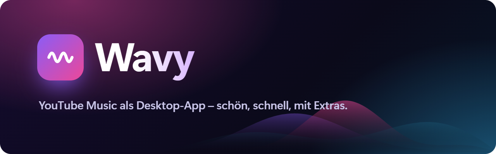
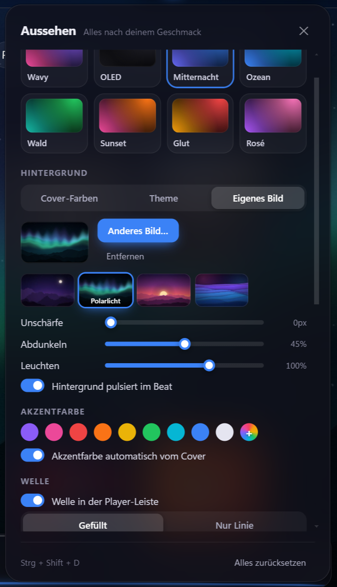
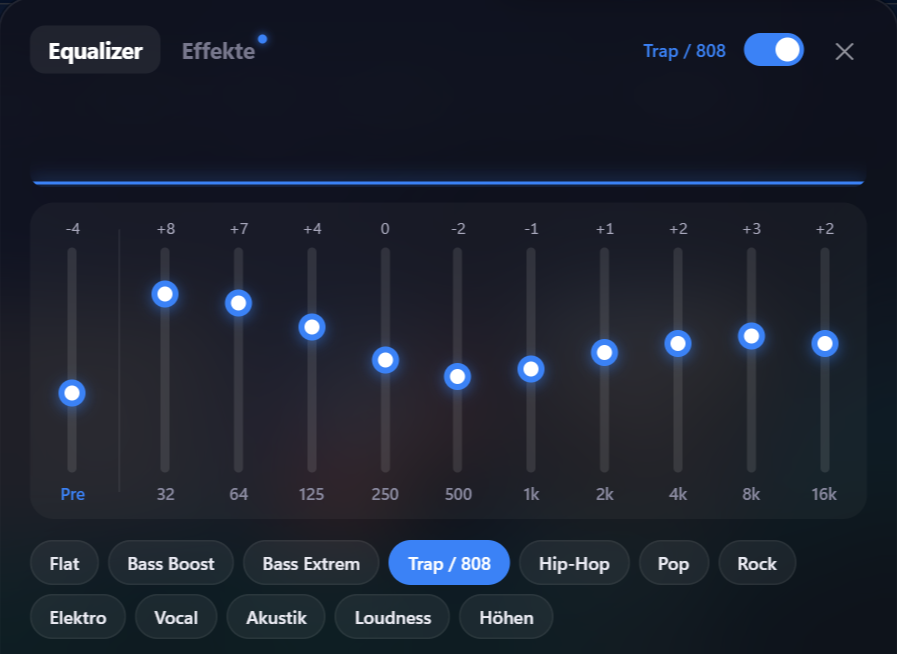
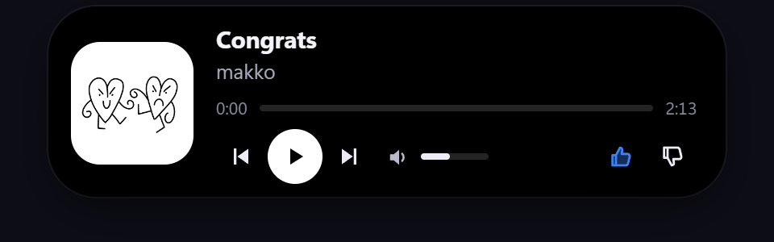

  

<a href="README.md">English</a> · <b>Deutsch</b>

  
  
  
  

**Wavy** ist ein Desktop-Player für **YouTube Music** – mit eigenem Design, Equalizer, Live-Wallpaper, Karaoke-Songtexten, Discord-Status und „Zusammen hören“ mit Freunden. Du meldest dich ganz normal mit deinem YouTube-/Google-Konto an, alles andere passiert lokal auf deinem PC. Wavy gibt es auf **Deutsch und Englisch** – es richtet sich nach deiner Systemsprache.

## Download

  
  
  

| System | Datei |
|---|---|
| **Windows 10/11** | `Wavy-Setup-x.y.z.exe` – aktualisiert sich danach selbst |
| **macOS** | `…-Mac-Apple-Silicon.dmg` (M1–M4) oder `…-Mac-Intel.dmg` – öffnen und Wavy in „Programme“ ziehen |
| **Linux** | `.AppImage` (aktualisiert sich selbst), `.deb` (Ubuntu/Debian), `.rpm` (Fedora/openSUSE), `.tar.gz` |
| **Android** | `Wavy-x.y.z-Android.apk` – antippen und installieren (Android 8+) |
| **iPhone** | `Wavy-x.y.z-iPhone.ipa` – per SideStore sideloaden, erneuert sich selbst im Hintergrund |

> **Windows zeigt „Der Computer wurde durch Windows geschützt“?** Wavy ist (noch) nicht mit einem kostenpflichtigen Zertifikat signiert. Auf **Weitere Informationen → Trotzdem ausführen** klicken. Wavy sammelt keine Daten und schickt nichts an fremde Server.

## Was Wavy kann

<table>
<tr>
<td width="50%" valign="top">

### Aussehen
- Eigene Themes, Akzentfarbe automatisch vom Album-Cover
- Hintergrund in Cover-Farben, Theme oder als Bild – vier eigene Hintergründe dabei
- Leuchtende Welle in der Player-Leiste, pulsiert im Beat
- Vollbild mit synchronen Songtexten und **Karaoke** (Wort für Wort)

### Sound
- **10-Band-Equalizer** mit Presets und eigenen Profilen
- Effekte: Bass-Boost, Hall, 8D, Tempo, Lautstärke-Ausgleich
- Eigener EQ pro Kopfhörer/Boxen, schaltet automatisch um

</td>
<td width="50%" valign="top">

</td>
</tr>
<tr>
<td width="50%" valign="top">

</td>
<td width="50%" valign="top">

### Extras
- **Dynamic Island** oben am Bildschirm, mit Lautstärke
- **Live-Wallpaper** – Welle, Balken oder Partikel hinter den Desktop-Symbolen
- **Lyrics-Overlay** über Spielen und anderen Apps
- **Freunde** – Songs schicken, sehen was Freunde hören, Wochen-Rangliste; ein Konto auf PC und Handy
- **Zusammen hören** – Raum-Code teilen, alle hören synchron
- **Schnellsuche** von überall mit eigener Tastenkombination
- **Discord-Status**, Last.fm-Scrobbling, Handy-Fernbedienung
- **RGB im Beat** – OpenRGB (Corsair, ASUS, MSI …), Razer Chroma, WLED, Hue, Govee
- Mini-Player, Desktop-Widget, Sleep-Timer, Wochen- und Jahresrückblick

</td>
</tr>
</table>

## Community

Fragen, Bugs, Ideen oder einfach dein Setup zeigen: **[Wavy-Discord beitreten](https://discord.gg/sMkQURNqbX)** – neue Versionen werden dort automatisch angekündigt. Deutsch und Englisch sind beide willkommen.

## Updates

Wavy schaut beim Start und alle paar Stunden nach einer neuen Version. Dann erscheint oben **„Update“** – ein Klick auf **„Jetzt updaten“**, Wavy startet neu und deine Einstellungen bleiben, wie sie sind. Danach zeigt Wavy kurz, was neu ist.

## Datenschutz

- Kein Tracking, keine Werbe-IDs.
- Einstellungen, Statistik und Verlauf liegen nur auf deinem PC (sicherbar als Datei).
- Verbindungen nur zu YouTube Music und zu Diensten, die du selbst einschaltest (Songtexte, Last.fm, Discord, Zusammen hören, Freunde).
- Das freiwillige Freunde-Konto speichert nur Anzeigenamen, Freundesliste und was du teilen willst. Bei Anmeldung mit Google oder E-Mail speichert Wavy nur Googles Kontonummer bzw. einen Hash der E-Mail – nie die Adresse selbst. „Konto löschen“ entfernt alles sofort.

---

Wavy ist ein inoffizielles Fan-Projekt und steht in keiner Verbindung zu YouTube oder Google. „YouTube Music“ ist eine Marke von Google LLC.
