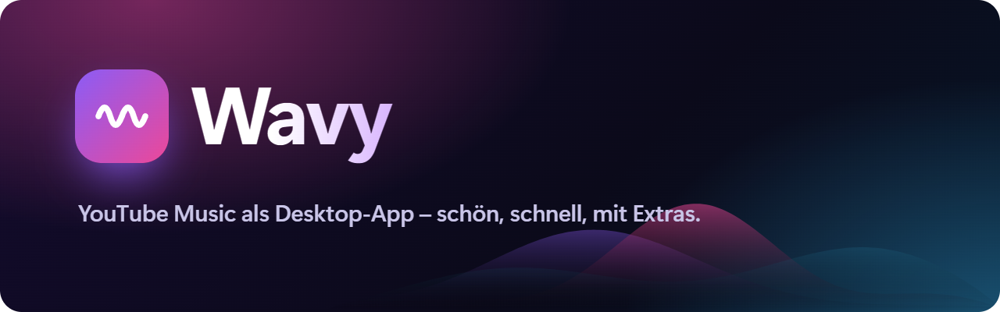
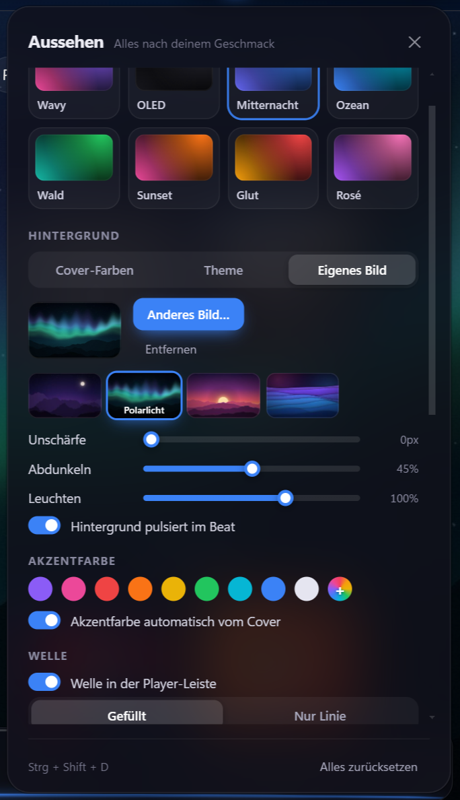
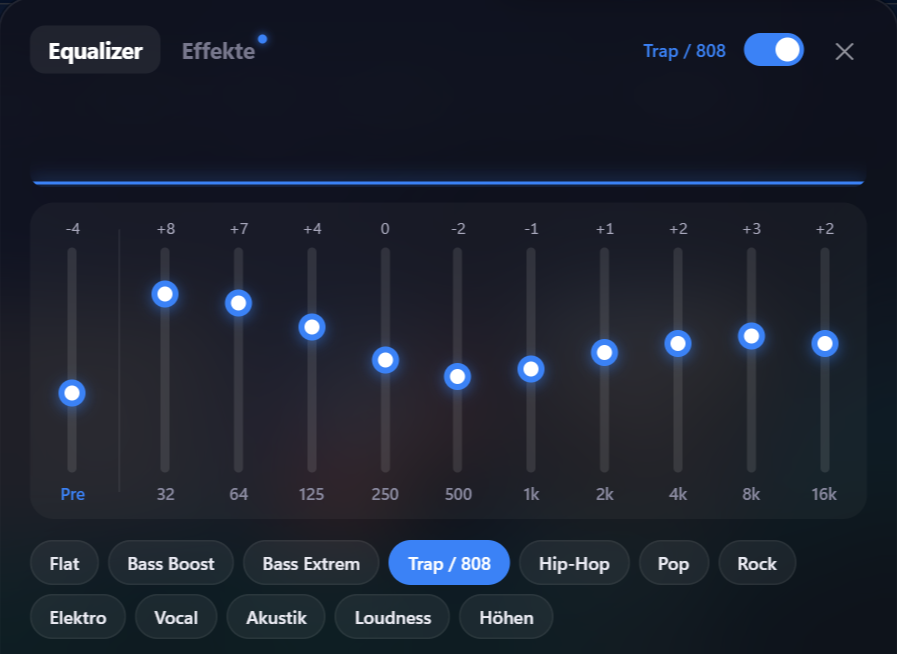
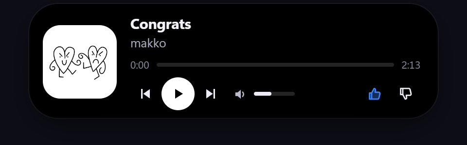

  

<b>English</b> · <a href="README.de.md">Deutsch</a>

  
  
  
  

**Wavy** is a desktop player for **YouTube Music** – with its own design, equalizer, live wallpaper, karaoke lyrics, Discord status, friends and “listen together”. You sign in with your normal YouTube/Google account; everything else happens locally on your PC. Wavy is available in **English and German** and follows your system language.

## Download

  
  
  
  

| System | File |
|---|---|
| **Windows 10/11** | `Wavy-Setup-x.y.z.exe` – updates itself afterwards |
| **macOS** | `…-Mac-Apple-Silicon.zip` (M1–M4) or `…-Mac-Intel.zip` – instructions are in the zip |
| **Linux** | `.AppImage` (updates itself), `.deb` (Ubuntu/Debian), `.rpm` (Fedora/openSUSE), `.tar.gz` |
| **Android** | `Wavy-x.y.z-Android.apk` – tap it and install (Android 8+) |
| **iPhone** | `Wavy-x.y.z-iPhone.ipa` – sideload with SideStore, refreshes itself in the background |

> **Windows says “Windows protected your PC”?** Wavy isn't signed with a paid certificate (yet). Click **More info → Run anyway**. Wavy doesn't collect data and doesn't send anything to third-party servers.

## What Wavy can do

<table>
<tr>
<td width="50%" valign="top">

### Look
- Custom themes, accent color taken from the album cover
- Background in cover colors, theme colors or as an image – four Wavy backgrounds included
- Glowing wave in the player bar that pulses to the beat
- Full screen with synced lyrics and **karaoke** (word by word)

### Sound
- **10-band equalizer** with presets and your own profiles
- Effects: bass boost, reverb, 8D, speed, volume normalization
- Separate EQ per headphones/speakers, switches automatically

</td>
<td width="50%" valign="top">

</td>
</tr>
<tr>
<td width="50%" valign="top">

</td>
<td width="50%" valign="top">

### Extras
- **Dynamic Island** at the top of your screen, with volume
- **Live wallpaper** – wave, bars or particles behind your desktop icons
- **Lyrics overlay** on top of games and other apps
- **Friends** – send songs, see what friends are listening to, weekly leaderboard; one account on PC and phone
- **Listen together** – share a room code, everyone hears the same thing in sync
- **Quick search** from anywhere with your own shortcut
- **Discord status**, Last.fm scrobbling, phone remote
- **RGB to the beat** – OpenRGB (Corsair, ASUS, MSI …), Razer Chroma, WLED, Hue, Govee
- Mini player, desktop widget, sleep timer, weekly and yearly recap

</td>
</tr>
</table>

## Phone

The Android and iPhone apps bring Wavy's look, the wave, full-screen lyrics, the equalizer and effects, friends and “listen together” (also with the PC) to your phone. Tap the Wavy logo at the top left to open the Wavy menu.

## Community

Questions, bugs, ideas or just showing off your setup: **[Join the Wavy Discord](https://discord.gg/sMkQURNqbX)** – new versions are announced there automatically. English and German are both welcome.

## Updates

Wavy checks for a new version at startup and every few hours. Then **“Update”** appears at the top – click **“Update now”**, Wavy restarts and your settings stay exactly as they are. Afterwards Wavy briefly shows what's new.

## Privacy

- No tracking, no advertising IDs.
- Settings, stats and history stay on your PC only (can be backed up as a file).
- Connections only go to YouTube Music and to services you turn on yourself (lyrics, Last.fm, Discord, listen together, friends).
- The optional friends account only stores your display name, friend list and what you choose to share. With Google or email sign-in, Wavy stores only Google's account number or a hash of your email – never the address itself. “Delete account” removes everything immediately.

---

Wavy is an unofficial fan project and is not affiliated with YouTube or Google. “YouTube Music” is a trademark of Google LLC.
